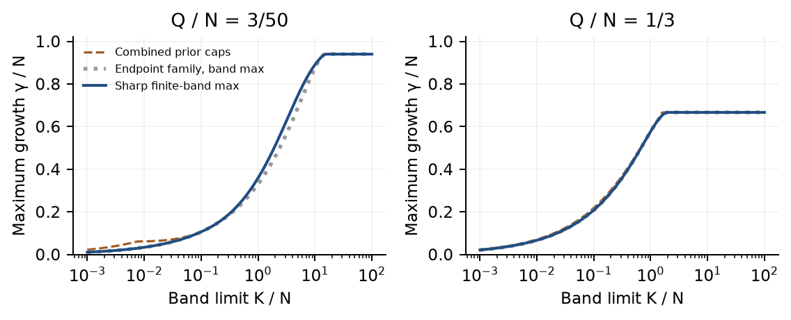

# Neutrino positive-moment bounds

**Exact frequency certificates and sharp growth bounds from incomplete angular information.**

Given a few angular moments, many positive neutrino distributions remain possible. This research toolkit checks frequency compatibility in a restricted fast-flavor model and computes sharp growth envelopes for the stated moment classes. It returns exact rational decisions, certificates and growth enclosures that can be replayed separately.

[Research draft](paper/research-draft.pdf) · [Full research guide](RESEARCH_GUIDE.md) · [Physical scope](PHYSICAL_SCOPE.md) · [Priority and usefulness](NOVELTY.md)



*Each point maximizes over potentially different compatible angular distributions. These curves are information bounds, not the dispersion relation of one physical background. The original figure and all research results are preserved.*

## Try an exact bound

The finite-band evaluator and exact certificate checks need only Python's standard library:

```sh
git clone https://github.com/nazeeh111/neutrino-positive-moments.git
cd neutrino-positive-moments
python3 -B -O verify_bundle.py
python3 -B finite_band_envelope.py --mass 1 --second 1/3 --kmax 1/1000
```

The evaluator reports `branch: endpoint` and the exact squared maximum `1333/3000000`, plus rational lower and upper bounds on growth. Use integers or rational strings for exact inputs. Add `--sector transverse` for the transverse factor.

The complete finite-band result assumes both positive species share moments **`(N, 0, Q)`**: equal mass, zero axial flux and equal second angular moment. It maximizes over compatible positive angular measures, every real frequency part and the supplied wave-number band. Endpoint, cubic-root and plateau regimes have explicit attaining completions; stable corners are handled separately.

[Written finite-band proof](finite-k-transition-audit.md) · [Separate geometric checker](independent_full_band_check.py) · [Recorded independent review](independent-full-band-review.md)

## Choose the question

| Question | Entry point | Scope |
| --- | --- | --- |
| Sharp maximum over a finite wave-number band | [finite_band_envelope.py](finite_band_envelope.py) | Equal supplied moments `(N, 0, Q)`; longitudinal or transverse |
| Frequency compatibility from separate mass, flux and second moments | [m2_frequency.py](m2_frequency.py) | Exact positive, axisymmetric completions; nonzero flux is supported |
| Replay a certificate without the production geometry or optimizer | [M1 verifier](independent_verifier.py), [M2 verifier](independent_m2_verifier.py) | Separate exact implementations for their documented certificate formats |
| Exclude a rational frequency from general 3D moments | [General frequency interface](nonaxial-exploration/general_frequency_certificate.py) | Sufficient exclusion only; unresolved does not mean compatible |

For a supplied-M2 example, run `python3 m2_frequency.py examples/m2-counterflux-input.json`. The [full guide](RESEARCH_GUIDE.md) maps the other evaluators, proofs, input examples and retained evidence.

## Evidence, with its limits

The delivered research includes independently checked frequency decisions, boundary cases, original-factor atomic attainers and a separate 19,800-case rational audit of the finite-band evaluator. These finite checks corroborate the written proofs; they do not replace them. The later full-frequency 3D bound has a separate, explicitly primary-checked proof for common isotropic full moments and still awaits independent review.

The strongest-cap comparison limits the isotropic finite-band improvement to **at most 5.72%**. The fixed counter-flux usefulness test failed its gate, and no general end-to-end speed advantage or operational astrophysical benefit has been demonstrated. Priority remains unestablished. Failed runs, corrections, raw results and review qualifications remain in the repository.

A compatible unstable mode need not occur in the actual background. Atomic completions do not establish smooth or occupation-constrained attainment. The model does not supply a physical ultraviolet cutoff, predict nonlinear conversion or validate supernova/merger behavior. The general unequal-moment finite-band problem remains open.

[Novelty assessment](NOVELTY.md) · [Utility review](utility-red-team.md) · [Remaining research](NEXT_RESEARCH.md) · [External review questions](EXTERNAL_REVIEW_BRIEF.md)

## Reproduce without replacing the evidence

Start with `verify_bundle.py`, which checks the delivered file hashes. Work in a copy before running the longer exact or numerical checks: some scripts write audit results. The [reproduction instructions](RESEARCH_GUIDE.md#reproduce) distinguish standard-library replays, optional numerical dependencies and paper builds. Historical drafts and original research records remain intact.

The research PDF is a **working draft**, not a submitted or peer-reviewed paper. The [presentation record](PRESENTATION_PROVENANCE.json) distinguishes the new front door from the unchanged research bundle and retained original guide. Code and data use the [MIT license](LICENSE).
