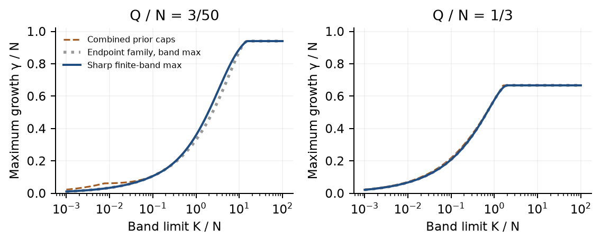

# Neutrino positive-moment bounds

Exact frequency-compatibility certificates and sharp growth bounds for a restricted neutrino fast-flavor model. The main theoretical result is a complete finite-wave-number envelope when both positive species have the same number moments `(N, 0, Q)`: mass, zero axial flux and second angular moment. It optimizes over **all compatible positive angular measures and every real frequency part**, with explicit distributions attaining each regime.

This is an information bound. A permitted unstable mode need not belong to the actual background, and different frequencies can require different completions. Scientific priority and practical astrophysical usefulness remain unestablished.

[Research draft](paper/research-draft.pdf) · [Physical scope](PHYSICAL_SCOPE.md) · [Novelty assessment](NOVELTY.md) · [Remaining research](NEXT_RESEARCH.md)

## Try the exact finite-band evaluator

The evaluator, certificate replays and exact tests use Python's standard library. No optimizer, angular grid or frequency scan is needed for this theorem.

```sh
python3 finite_band_envelope.py --mass 1 --second 1/3 --kmax 1/1000
python3 -B -O test_finite_band_envelope.py
python3 -B -O independent_full_band_check.py
```

The first example returns the exact squared maximum `1333/3000000`, together with rational enclosures of the growth rate. Inputs are exact integers or rational strings. The default is longitudinal; add `--sector transverse` for the transverse factor.

The three regimes are an endpoint-family expression, the positive root of a cubic, and a constant plateau. Their transitions are decided by rational inequalities. Positive two- or three-atom measures prove attainment. Stable corner cases are handled separately. See [the full proof](finite-k-transition-audit.md) and [fresh independent review](independent-full-band-review.md).



Each point in this figure optimizes over a potentially different angular completion. The earlier enclosing-disk bound can be loose; one fixed endpoint family misses the interior cubic regime. These curves are not the dispersion relation of one physical background.

## Other executable results

| Entry point | Question answered |
|---|---|
| `m2_frequency.py` | Can some positive completion of separate species moments `(N, M, Q)` have a specified complex frequency? Nonzero flux is supported. |
| `moments.py`, `geometry.py` | Exact four-disk compatibility with supplied mass and flux. The shared module also imports the numerical comparison dependencies. |
| `second_moment_bounds.py` | Sharp all-wave-number growth caps and positive attainers with separate second moments, including essential stable corners. |
| `independent_verifier.py`, `independent_m2_verifier.py` | Separate exact proof checkers that import no production geometry or optimizer. |

For a supplied-M2 example:

```sh
python3 m2_frequency.py examples/m2-counterflux-input.json
python3 -B -O verify_m2_screen.py
```

General M2 completions can require three atoms. Its interface emits existence certificates; it does not emit a full numerical atom listing. The earlier M1 two-atom guarantee does not carry over unchanged.

Additional sharp results cover fixed wave number with equal masses and zero flux but no prescribed second moment, and the all-wave-number maximum with separately supplied second moments. The complete finite-band theorem concerns **equal** supplied second moments; the general unequal-moment finite-band problem remains open.

## Evidence and negative results

- All **504** planned frequency decisions and **90** designed boundary/scaling cases have independent exact checks. The screen includes 72 possible and 432 impossible decisions.
- A strong continuous Clarabel comparison covers **722** cases. Exact geometry certifies all 722; the conic route certifies 682 and leaves 40 designed stress cases unresolved, with no certified disagreement. Including proof checking, the conic route is typically faster. **No general end-to-end speed advantage is demonstrated.**
- The complete finite-band extension has 1,000 exact disk identities, **276 original-factor atomic attainers**, 36 exact transition cases and 150 enclosure/scaling cases. A separate geometric implementation checks **19,800** rational cases. These finite checks corroborate the written universal proof; they do not replace it.
- Positive smooth distributions share their first and second number moments with a stable isotropic pair yet have growing roots. Four of six fixed smoothing cases have Arb-certified root brackets; the two missing brackets are not stability claims.
- The fixed published counter-flux test **failed its usefulness gate**: all eight reproduced growing closure modes remain compatible with both M1 and M2. No wider grid or different closure was substituted to manufacture a pass. Thirteen original linear-input root brackets have separate Arb validation.

Raw data, plans, reviews and failed initial runs are retained. The first screen's type-conversion failure and the continuous comparison's conditioning correction are disclosed. Four development smoke points overlapped the planned screen; the records were not externally timestamp-registered. No results are relabeled as held-out astrophysical data.

## Reproduce

Check the delivered bytes before regenerating outputs:

```sh
python3 -B -O verify_bundle.py
python3 -B -O verify_all.py
python3 -B -O independent_continuous_replay.py
```

The file manifest covers the delivered research files and excludes itself. Regeneration writes result files, so preserve the archive or work in a copy. The standard-library GitHub workflow checks manifest hashes, certificate replays, exact algebra and the global/finite-band results. It does not regenerate numerical benchmarks, rebuild the PDF or replace the documented Arb/SciPy checks.

For full numerical reproduction, the tested environment is CPython 3.12.15, NumPy 2.3.5, SciPy 1.18.1 and python-flint 0.9.0:

```sh
python3.12 -m venv .venv
.venv/bin/python -m pip install -r requirements.txt
POSITIVE_MOMENT_PYTHON=.venv/bin/python sh reproduce.sh
```

The strong continuous comparison additionally uses the separate [baseline requirements](baseline-requirements.txt); its generation code and frozen plan are `baseline_continuous_exploration.py` and `independent-continuous-review.plan.md`. Replaying its serialized certificates needs only the standard library.

To rebuild the paper with the same figure and typesetting packages:

```sh
.venv/bin/python -m pip install -r paper-requirements.txt
PYTHONDONTWRITEBYTECODE=1 MPL_IGNORE_SYSTEM_FONTS=1 .venv/bin/python paper/build.py
```

The build retains the last successful PDF until its replacement compiles and renders. The current render has visual QA; older valid drafts remain under `paper/history/`. The PDF is a working draft, not a submitted or peer-reviewed paper.

## Scope and prior work

The model assumes positive axisymmetric angular measures, propagation along the symmetry axis, local collisionless fast evolution and explicit pointwise heavy-flavor cancellation. Moments are number weighted. Atomic extrema do not establish exact attainment under smoothness or occupation constraints. No physical ultraviolet cutoff, general three-dimensional uncertainty result, universal-instability classifier, nonlinear-conversion prediction or actual supernova/merger validation is claimed.

Weyl disks, Hausdorff positivity, completion ambiguity, moment-only zero-mode diagnostics, beam growth formulas and generic disk mixtures are established tools. The candidate contribution is the specialized exact diagnostic and the sharp constrained extrema with their attaining completions. The [priority record](full-band-priority-update.md) distinguishes those claims from direct predecessors. Bounded searches and model-agent reviews do not establish priority or external human validation.

[EXTERNAL_REVIEW_BRIEF.md](EXTERNAL_REVIEW_BRIEF.md) provides focused priority/usefulness questions. No expert correspondence or paper submission has occurred. The code and data are released under the [MIT license](LICENSE).


## Nonaxial scope check

An [exact eight-angle example](nonaxial-isotropic-audit.md) has positive species with identical density, zero vector flux and second tensor I/3, yet grows at rate1/3 while azimuthal averaging makes their signed angular distributions identical. This illustrates why projecting a nonaxial background can erase instability. It does not violate the published axial envelope or establish its extension to3D. Symmetry-breaking flavor instabilities are established prior physics.

Run `python3 -B -O nonaxial-exploration/exact_projection_counterexample.py` for the exact original-equation check. A separate retained13,500-case rotated-tetrahedron exploration found no axial-bound violation; absence of a counterexample is inconclusive. See the audit and `nonaxial-exploration/PLAN.md` for limits and the weaker general growth bound.


## Current novelty and usefulness assessment

[Independent priority attack](priority-red-team.md) finds the complete finite-band envelope a plausible specialized theorem contribution, with no identical result located in the bounded search. It does not establish priority. The generic classifier substantially specializes classical moment methods. [Independent utility review](utility-red-team.md) finds no demonstrated operational astrophysical advantage.

The corrected comparison includes all three applicable previous caps. For isotropic second moments, the complete theorem tightens their minimum by at most **5.72%**; `usefulness-assessment/compare_bounds.py` retains exact corroborating comparisons. The earlier figure omitted the mass/flux cap and has been corrected. Also, the diagnostic must accept any exact root of a positive quadrature preserving its supplied moments, so it cannot generally filter discretization-induced spurious modes. The theorem remains a quantitative information limit and a potential regression reference. Neither role yet establishes the requested high-impact scientific usefulness.


A [focused published-advection case review](advection-usecase-gate.md) found that fitted growth rates and Fourier peaks alone do not supply the complete modes required for certified exclusion. For consistent fixed scalar longitudinal closures, an explicit operator equivalence to positive two-node quadratures shows why the same moment class must accept their growing roots. Run `python3 -B -O usefulness-assessment/closure_equivalence.py` for200 exact operator identities and an independently checked original-factor example. This conditional result does not describe the full FLASH tensor closure or its nonlinear advection, and it does not constitute a new practical-use pass.
